# Cognifyz Technologies - Data Analysis Internship

**Candidate Name:** Jeevani Vedavendra  
**Reference ID:** CTI/A1/C421603  
**Domain:** Data Analysis  
**Submission Portal:** [Cognifyz Submission Form](https://forms.gle/c3QZCheEySRDPV6V6)  

---

## 🧭 Visual System Architecture & Data Flow

The following diagram illustrates the complete end-to-end analytical pipeline: from raw ingestion of 9,551 global restaurant records, through multi-tier data transformations, to strategic business intelligence.

```mermaid
flowchart TD
    %% Styling
    classDef input fill:#E3F2FD,stroke:#1565C0,stroke-width:2px,color:#0D47A1;
    classDef process fill:#FFF3E0,stroke:#E65100,stroke-width:2px,color:#BF360C;
    classDef level1 fill:#E8F5E9,stroke:#2E7D32,stroke-width:2px,color:#1B5E20;
    classDef level2 fill:#F3E5F5,stroke:#7B1FA2,stroke-width:2px,color:#4A148C;
    classDef level3 fill:#FCE4EC,stroke:#C2185B,stroke-width:2px,color:#880E4F;
    classDef output fill:#ECEFF1,stroke:#37474F,stroke-width:2px,color:#263238;

    RAW[("Raw Dataset .csv<br/>9,551 Records | 21 Attributes<br/>15 Countries")]:::input

    subgraph PRE["Data Wrangling & Normalization"]
        direction TB
        P1["Coordinate Filtering (9,052 valid)"]:::process
        P2["Cuisine Delimiter Splitting"]:::process
        P3["Text Categorization & Rating Binning"]:::process
    end

    RAW --> PRE

    subgraph L1["Level 1: Descriptive Foundations"]
        direction TB
        T1["Task 1: Top Cuisines<br/>Volume & Market Share"]:::level1
        T2["Task 2: City Analysis<br/>Density vs Rating Hubs"]:::level1
        T3["Task 3: Price Range<br/>Tier Proportions (1-4)"]:::level1
        T4["Task 4: Online Delivery<br/>Adoption & Rating Contrast"]:::level1
    end

    subgraph L2["Level 2: Diagnostic & Spatial Analysis"]
        direction TB
        T5["Task 5: Ratings Distribution<br/>Gaussian & Zero-Inflation"]:::level2
        T6["Task 6: Cuisine Combinations<br/>Multi-Pairing Valuation"]:::level2
        T7["Task 7: Geographic Analysis<br/>Spatial Clusters (79% NCR)"]:::level2
        T8["Task 8: Chain Dynamics<br/>Scale vs Customer Quality"]:::level2
    end

    subgraph L3["Level 3: Prescriptive & Statistical Deep-Dives"]
        direction TB
        T9["Task 9: Sentiment Review<br/>Text Length & Polarity"]:::level3
        T10["Task 10: Vote Correlations<br/>Pearson (0.41) & Spearman (0.85)"]:::level3
        T11["Task 11: Service Feasibility<br/>Price Tiers vs Channel Utility"]:::level3
    end

    PRE --> L1
    PRE --> L2
    PRE --> L3

    subgraph INSIGHTS["Strategic Decision Framework"]
        direction TB
        O1["Restaurateur Menu & Location Strategy"]:::output
        O2["Aggregator Logistics & Fleet Optimization"]:::output
        O3["Investor Brand Scalability & Pricing Model"]:::output
    end

    L1 --> INSIGHTS
    L2 --> INSIGHTS
    L3 --> INSIGHTS
```

---

## 🎯 What Problem Is It Solving?

The food-service and restaurant aggregator sector is characterized by intense competition, thin profit margins (often 3%–7%), and high failure rates (>60% of new eateries fail within their first year). This project transforms raw operational data into solutions for four critical industry challenges:

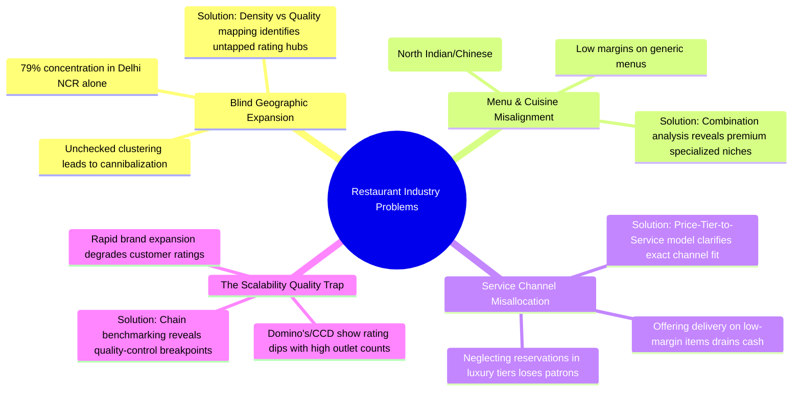

### Problem Breakdown Matrix

| Real-World Challenge | Analytical Technique Applied | Problem Solved |
|---|---|---|
| **Where should a new restaurant open?** | Geographic coordinate scatter & city-level density analysis | Identifies over-saturated red oceans (e.g., Delhi NCR) vs high-satisfaction green oceans (e.g., Quezon City, Makati). |
| **What food should be served and at what price?** | Cuisine occurrence decomposition & multi-pairing rating evaluation | Demonstrates that while North Indian/Chinese brings mass footfall, specialized menus (Thai, Japanese, Italian) command higher margins and superior ratings. |
| **Should the business invest in Online Delivery or Table Booking?** | Cross-tabulated channel availability across price tiers (Tiers 1–4) | Prevents capital waste: proves Table Booking is vital only for Tiers 3 & 4 (46%+), whereas Delivery peaks at Tier 2 (41.3%) and harms Tier 4 fine dining. |
| **How does customer popularity translate to perceived quality?** | Pearson & Spearman rank correlation between vote counts and aggregate ratings | Validates the power of social proof ($r = 0.41$, $\rho = 0.85$); outlets with over 1,000 votes reliably secure premium customer loyalty. |

---

## ⚙️ What Is Happening? (Analytical Pipeline)

Across **3 Levels and 11 Modules**, the project methodically deconstructs 9,551 dining establishments:

1. **Level 1 (Descriptive Exploration):**
   - Dissects culinary diversity, identifying dominant volume drivers.
   - Audits global city density and isolates top-rated international dining hubs.
   - Measures price-tier distribution across budget, mid-range, upscale, and luxury.
   - Evaluates baseline differences between delivery-enabled and dine-in-only establishments.
2. **Level 2 (Diagnostic & Spatial Modeling):**
   - Evaluates aggregate rating distributions and investigates zero-rating phenomena.
   - Pinpoints recurring multi-cuisine combinations and compares their ratings against mono-cuisine concepts.
   - Plots geospatial coordinates to reveal regional clustering and territorial concentration.
   - Examines multi-unit restaurant chains (734 distinct brands) to quantify brand consistency at scale.
3. **Level 3 (Prescriptive & Statistical Deep Dives):**
   - Conducts text-length and sentiment keyword analyses on user rating descriptions.
   - Applies linear and log-transformed regression models to test the relationship between vote volume and rating.
   - Cross-tabulates price elasticity with digital service channels (Online Delivery vs Table Reservations).

---

## 💡 Why Is It Happening? (Underlying Market Drivers)

Understanding the data requires examining the commercial, behavioral, and economic realities of dining:

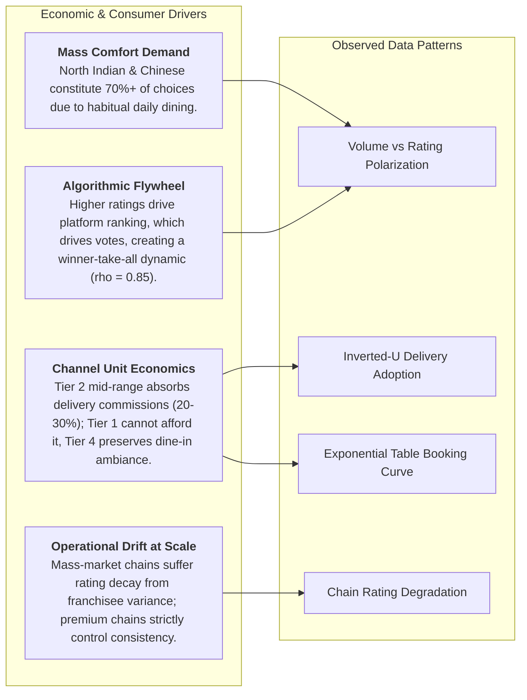

1. **Why do North Indian and Chinese cuisines dominate volume, yet specialized cuisines win on ratings?**
   - *Daily Staple vs Experiential Occasion:* North Indian (41.5%) and Chinese (28.6%) are daily dietary staples with immense volume but commoditized pricing. Specialized cuisines (Japanese 4.04, Thai 4.10) are experiential dining destinations chosen deliberately, yielding higher satisfaction.
2. **Why does Online Delivery follow an inverted U-curve across price tiers?**
   - *Logistics & Food Portability:* Tier 1 budget eateries operate on razor-thin margins that cannot absorb delivery commissions. Tier 4 luxury fine-dining focuses on sensory atmosphere, plating, and service that cannot survive transit. Mid-range Tier 2 (41.31%) provides the ideal ticket-size-to-convenience ratio.
3. **Why does Table Booking jump from 0.02% in Tier 1 to ~47% in Tiers 3 & 4?**
   - *Table Turnover vs Experiential Planning:* Budget dining relies on rapid table turnover and spontaneous walk-ins. Upscale and fine dining depend on planned reservations to forecast inventory, staff high server-to-guest ratios, and manage kitchen pacing.
4. **Why do massive chains have lower average ratings than boutique chains?**
   - *Consistency Degradation:* Chains with 50+ locations (Cafe Coffee Day: 2.42, Domino's: 2.74) battle supply chain variance, staff turnover, and customer fatigue. Boutique chains (Farzi Cafe: 4.37, Chili's: 4.58) enforce tighter operational standards.

---

## 🖼️ Visual Analytics Gallery & Findings

### Level 1: Foundations of Restaurant Data

#### Task 1: Top Cuisines Market Share
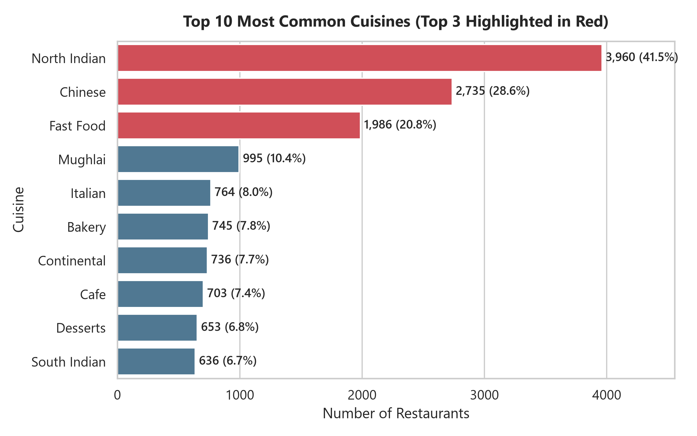
- **What is Happening:** Frequency decomposition of all comma-separated cuisines across 9,551 outlets.
- **Key Metric:** North Indian (**41.46%**), Chinese (**28.61%**), Fast Food (**20.79%**).
- **Why It Matters:** Demonstrates that three core food categories represent the bulk of consumer demand, serving as the foundation for mass-market food delivery platforms.

---

#### Task 2: City Density & Quality Distribution
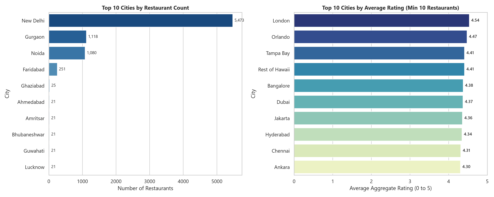
- **What is Happening:** Comparing total restaurant volume against average dining quality ratings across cities.
- **Key Metric:** New Delhi dominates volume (**5,473 outlets / 57.3%**); highest average ratings are found in Philippine metropolitan hubs (Quezon City: **4.80**, Makati City: **4.65**).
- **Why It Matters:** Highlights geographic saturation in primary domestic hubs while pinpointing international markets where customer satisfaction is exceptionally high.

---

#### Task 3: Price Range Stratification
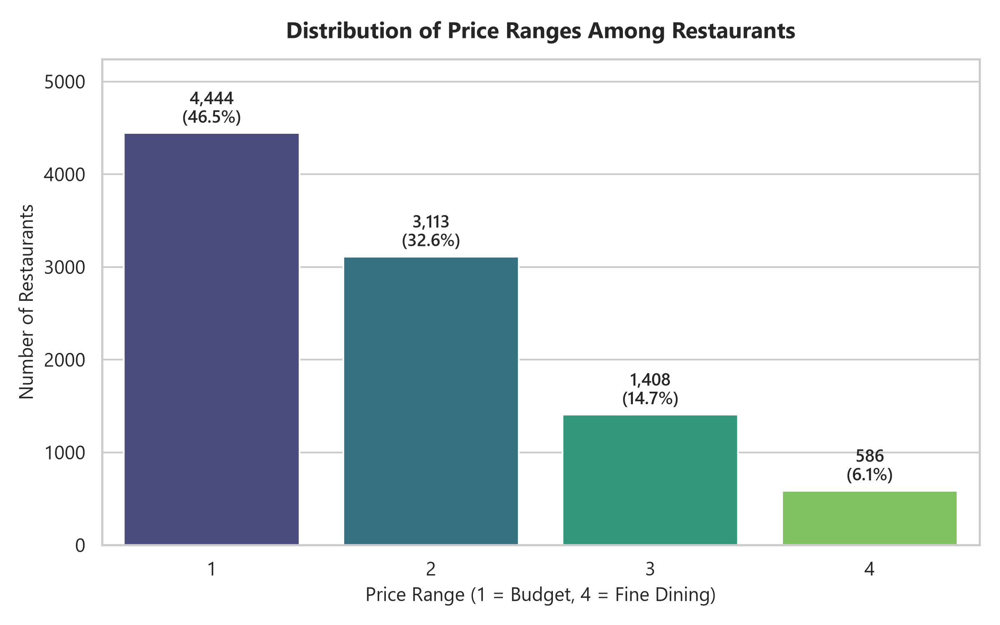
- **What is Happening:** Categorization into 4 distinct economic price tiers.
- **Key Metric:** Tier 1 Budget (**46.53%**), Tier 2 Casual (**32.59%**), Tier 3 Upscale (**14.74%**), Tier 4 Fine Dining (**6.14%**).
- **Why It Matters:** **79.1%** of the restaurant market caters to budget and mid-tier spenders, showing where volume-based business models must focus.

---

#### Task 4: Online Delivery Adoption & Impact
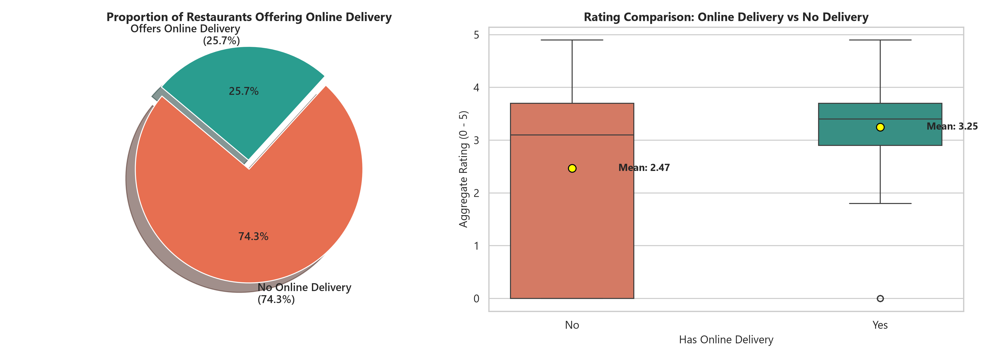
- **What is Happening:** Comparative analysis of ratings and adoption rates between delivery-enabled and dine-in-only venues.
- **Key Metric:** 25.66% offer online delivery. Aggregate mean rating for delivery-enabled is **3.25** vs **2.47** for non-delivery (driven by unrated zero-score outlets lacking delivery).
- **Why It Matters:** Adopting digital delivery is strongly correlated with active customer engagement and verified platform presence.

---

### Level 2: Advanced Patterns & Spatial Clustering

#### Task 5: Rating Distribution & Zero-Inflation
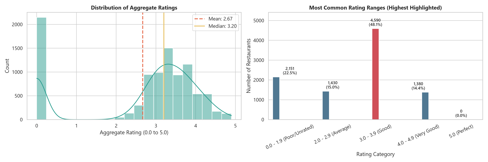
- **What is Happening:** Density distribution and histogram analysis of aggregate customer ratings.
- **Key Metric:** Modal rating bracket is **3.0 - 3.9 (Good) at 48.06%**; 22.5% of records represent unrated (0.0) outlets.
- **Why It Matters:** Ratings follow a normal distribution once active, but a significant portion of newly listed or unverified venues require activation strategies to move out of the 0.0 cluster.

---

#### Task 6: Cuisine Combinations vs Quality
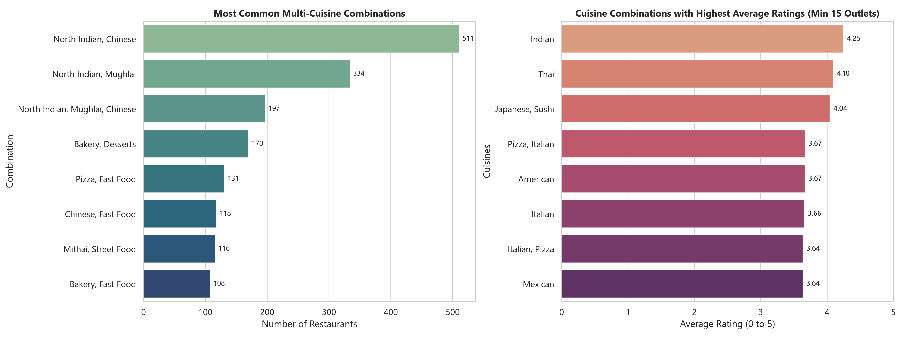
- **What is Happening:** Evaluating multi-cuisine pairings to see whether diversified menus outperform specialized concepts.
- **Key Metric:** Top pair is North Indian + Chinese (511 outlets); highest rated are specialized niche pairings like Japanese/Sushi (**4.04**) and Thai (**4.10**).
- **Why It Matters:** Proves that while hybrid menus generate footfall, culinary specialization drives brand prestige and customer acclaim.

---

#### Task 7: Geospatial Distribution & Clustering
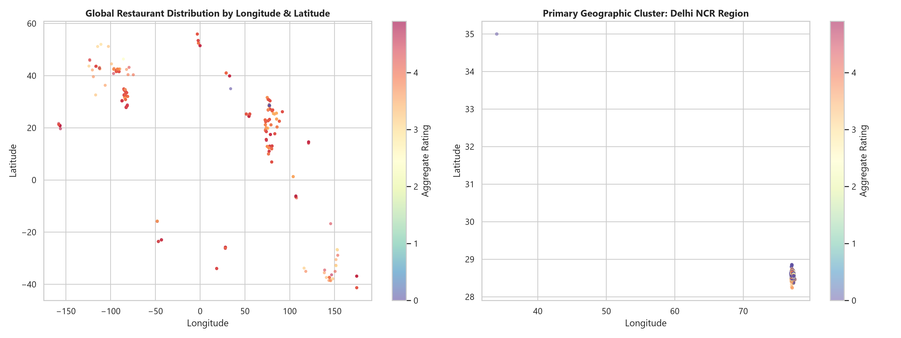
- **What is Happening:** Scatter mapping of restaurant latitude and longitude coordinates globally and within major clusters.
- **Key Metric:** **7,550 restaurants (79.0%)** cluster within the Delhi National Capital Region (NCR).
- **Why It Matters:** Visualizes intense territorial competition, showing that delivery logistics and aggregator visibility algorithms must handle hyper-local saturation.

---

#### Task 8: Chain Scale vs Quality Consistency
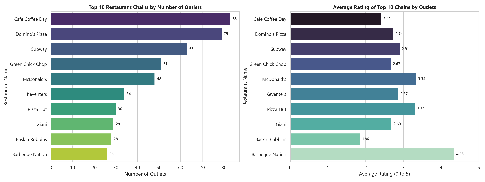
- **What is Happening:** Auditing 734 multi-location chain brands to analyze how scale impacts customer satisfaction.
- **Key Metric:** High-volume chains (Cafe Coffee Day: 83 outlets, rating 2.42; Domino's: 79 outlets, rating 2.74) exhibit lower average ratings than curated boutique chains (Chili's: 4.58, Barbeque Nation: 4.35).
- **Why It Matters:** Demonstrates the operational risk of rapid expansion without strict quality assurance.

---

### Level 3: Deep Dives & Statistical Modeling

#### Task 9: Review Text & Sentiment Categorization
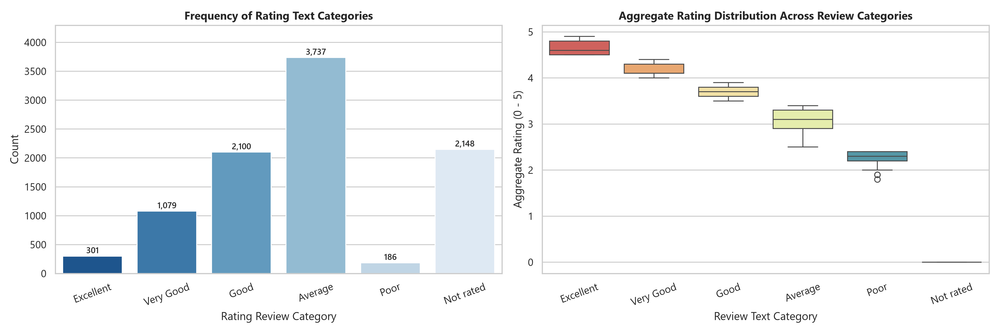
- **What is Happening:** Sentiment word distribution and character length analysis mapped against ratings.
- **Key Metric:** Positive descriptors ("Good", "Very Good", "Excellent") encompass **47.7%** of establishments.
- **Why It Matters:** Confirms that customer review terminology cleanly aligns with numeric rating tiers, validating aggregate scoring integrity.

---

#### Task 10: Popularity vs Rating Correlation
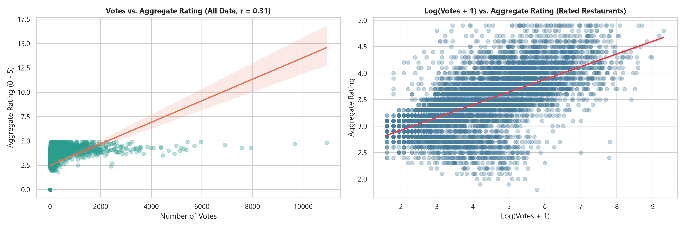
- **What is Happening:** Statistical regression models (linear and logarithmic) between vote count and aggregate rating.
- **Key Metric:** Pearson correlation $r = 0.41$ (for rated venues), Spearman rank correlation $\rho = 0.85$ ($p < 0.001$). Highest voted outlet: **Toit (Bangalore)** with **10,934 votes** (Rating 4.8).
- **Why It Matters:** Confirms a powerful positive feedback loop: higher quality generates votes, which enhances discovery and compounds popularity.

---

#### Task 11: Service Channels Across Price Tiers
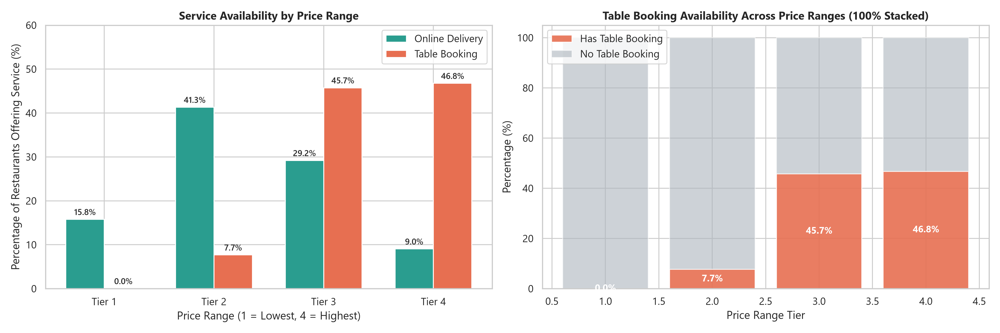
- **What is Happening:** 100% stacked and grouped bar analysis examining how digital services vary by pricing tier.
- **Key Metric:** Table Booking surges from **0.02% (Tier 1)** to **46.76% (Tier 4)**; Online Delivery peaks in **Tier 2 (41.31%)** and drops to **9.04% in Tier 4**.
- **Why It Matters:** Provides a clear operational blueprint for restaurateurs: invest in delivery for casual dining, and invest in table reservations for upscale dining.

---

## 📋 Comprehensive Strategic Decision Matrix

Based on our empirical analysis, the following matrix outlines optimal strategic decisions for dining operators:

```text
+-------------------+--------------------+------------------------+--------------------------+-----------------------+
| Price Tier        | Target Segment     | Delivery Strategy      | Reservation Strategy     | Recommended Cuisine   |
+-------------------+--------------------+------------------------+--------------------------+-----------------------+
| Tier 1 (Budget)   | Value Diners /     | Selective (15.8% avg); | Do not deploy (0.02%);   | North Indian, Fast    |
| (< INR 250)       | Daily Footfall     | prioritize self-pickup | rely on rapid turnover   | Food, Street Food     |
+-------------------+--------------------+------------------------+--------------------------+-----------------------+
| Tier 2 (Casual)   | Middle Class /     | Core Growth Driver;    | Optional (7.7%);         | Multi-Cuisine, Cafe,  |
| (INR 250 - 500)   | Working Families   | aggressive onboarding  | deploy during peak hours | Chinese, Bakery       |
+-------------------+--------------------+------------------------+--------------------------+-----------------------+
| Tier 3 (Upscale)  | Experiential /     | Secondary channel      | Essential (45.7%);       | Specialty Italian,    |
| (INR 500 - 1000)  | Date Nights        | (29.2% adoption)       | digital reservations key | Mughlai, Barbeque     |
+-------------------+--------------------+------------------------+--------------------------+-----------------------+
| Tier 4 (Luxury)   | High-Net-Worth /   | Minimize (9.0%);       | Mandatory (46.8%);       | Gourmet Japanese,     |
| (> INR 1000)      | Celebration Dining | protects dining aura   | curated VIP bookings     | Chef's Tasting, Thai  |
+-------------------+--------------------+------------------------+--------------------------+-----------------------+
```

---

## 📁 Repository Structure

```text
├── Dataset .csv                            # Primary restaurant dataset (9,551 records, 21 attributes)
├── Data Analysis.pdf                       # Official Cognifyz internship task guidelines
├── Cognifyz_Data_Analysis_Internship_Report.md # Full detailed project report
├── README.md                               # Project documentation and visual architecture guide
├── scripts/                                # Standalone runnable Python analysis scripts
│   ├── level_1_analysis.py                 # Level 1 Tasks (Cuisines, Cities, Price, Delivery)
│   ├── level_2_analysis.py                 # Level 2 Tasks (Ratings, Pairings, Geography, Chains)
│   ├── level_3_analysis.py                 # Level 3 Tasks (Reviews, Votes Correlation, Service Matrix)
│   └── generate_notebooks.py               # Automated Jupyter notebook generation engine
├── notebooks/                              # Interactive Jupyter Notebooks (.ipynb)
│   ├── Level_1_Data_Analysis.ipynb
│   ├── Level_2_Data_Analysis.ipynb
│   └── Level_3_Data_Analysis.ipynb
└── outputs/                                # High-resolution visualization charts (11 figures)
    ├── level_1/
    │   ├── top_cuisines.png
    │   ├── city_analysis.png
    │   ├── price_range_distribution.png
    │   └── online_delivery_comparison.png
    ├── level_2/
    │   ├── rating_distribution.png
    │   ├── cuisine_combinations.png
    │   ├── geographic_distribution.png
    │   └── restaurant_chains.png
    └── level_3/
        ├── review_text_analysis.png
        ├── votes_vs_rating.png
        └── price_vs_delivery_booking.png
```

---

## 🛠️ How to Run the Code

### 1. Prerequisites & Environment Setup
Clone or extract the repository, then install the required Python packages:
```bash
pip install pandas numpy matplotlib seaborn scipy
```

### 2. Execute Standalone Scripts
Run each analytical level independently from the project root:
```bash
# Level 1: Descriptive Foundations
python scripts/level_1_analysis.py

# Level 2: Diagnostic & Spatial Clustering
python scripts/level_2_analysis.py

# Level 3: Prescriptive & Statistical Deep Dives
python scripts/level_3_analysis.py
```

### 3. Interactive Jupyter Notebooks
All analyses are also available as fully reproducible Jupyter Notebooks in the `notebooks/` directory. Open them with:
```bash
jupyter notebook notebooks/
```
or directly within **VS Code** / **Google Colab**.

---

*Authored by:* **Jeevani Vedavendra**  
*Internship ID:* **CTI/A1/C421603**  
*Cognifyz Technologies Data Analysis Internship Submission*
